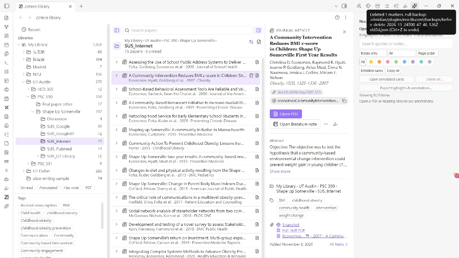

# Noctilucent ✦

**Highlight freely. Annotate naturally. Stay focused.**

A reading-first Obsidian plugin for highlighting, in-context annotations, flexible reading tools, and customizable Markdown exports.

**Version:** 0.2.4 · **Platform:** Desktop · **License:** MIT · **Minimum Obsidian:** 1.12.0

**Language:** English | [繁體中文](README.zh-TW.md)

[Changelog](CHANGELOG.md) · [Community Plugins](https://community.obsidian.md/plugins/noctilucent)

## About Noctilucent

The name is inspired by noctilucent clouds, the silvery-blue clouds that glow in high-latitude summer nights. It evokes the quiet hours before dawn, when distractions fade and only the screen and your thoughts remain illuminated.

Created for reading academic literature in Obsidian, Noctilucent brings highlighting, annotation and research notes together without sacrificing reading space.

**The annotation tool should adapt to the reader, not the reader to the annotation tool.**

## What's new in v0.2.4

Since the public v0.1.9 release:
- Three floating toolbar layouts: vertical, horizontal and collapsed icon.
- Independent toolbar layout, position, color and continuous highlighting in each live reading view.
- Three annotation display modes: collapsed, text preview and editable cards.
- Seven Markdown export layouts, two grouping modes and customizable fields and destination.
- Experimental EPUB integration, including image-region styles, opacity, copying and adjustment.
- Markdown fenced and inline code highlighting in Reading View.
- Independent document-format switches, PDF performance improvements, and improved sidebar focus and EPUB card placement.

## Core features

### 1. Highlight and annotate in context
Highlight without requiring a note. Add comments later, hover over a comment marker for a text preview, or click to open a movable editing card near the passage. Multiple cards can remain open.

### 2. Eight pastel colors and continuous highlighting
Choose from yellow, orange, pink, green, blue, purple, cyan and gray. Assign your own meanings, such as research aims, methods or findings. Continuous mode lets you highlight repeatedly without returning to the toolbar.

### 3. Three annotation tools
- Text highlighting for important passages.
- Free-position notes in PDF; text-anchored free notes in EPUB.
- Area highlighting for PDF figures, tables and non-text content, and individual supported EPUB images.

PDF and EPUB image-region marks offer translucent fill, colored border, or fill plus border, adjustable fill opacity, area adjustment and image copying where supported.

### 4. Flexible floating toolbar
Drag the toolbar and cycle through vertical, horizontal and collapsed-icon modes. In split views, layout, position, selected color and continuous highlighting are independent. Special tools such as PDF drawing and PDF/Markdown erasers retain exclusive behavior. Annotation records remain shared. Eraser and session-based undo/redo help correct supported operations; not every deletion is undoable.

### 5. Three annotation display modes
Use the sidebar control to cycle **collapsed → text preview → editable cards → collapsed**. Preview shows concise note text near visible markers without opening full editors. Cards support editing. Normal hover previews remain available.

### 6. Annotation sidebar
Search quotations and notes, filter by color, sort by document order or creation time, navigate to resolvable anchors, edit notes and colors, pin important items (up to three per document), switch list density, copy annotations, lock the current document and use bulk deletion with a backup safeguard.

### 7. Research-oriented Markdown export
Export quotations and notes into independent snapshots for literature reviews, reports and study notes.

| Layout | Purpose |
|---|---|
| Cards | Card-based notes |
| Report | Structured report |
| Sections | Section-based notes |
| Parallel | Side-by-side quotation and comment |
| Matrix | Table-like comparison grid |
| Minimal | Compact layout |
| Plain | Native Markdown |

Each layout supports document order + pinned items or color grouping. Six styled layouts show a proportional color-distribution strip and use plugin CSS; Plain does not require that styling. Choose a Vault-relative destination and fields: source link, location, quotation, note, type, color, creation/modification time, pin status and ID. Exports are snapshots, not live synchronization; existing exports are not overwritten. Region screenshots are not embedded automatically.

### 8. Multi-format reading

| Feature | PDF | Markdown | DOCX/PPTX | EPUB |
|---|---|---|---|---|
| Text highlights and notes | Yes | Yes | Preview | Preview |
| Continuous highlighting | Yes | Yes | Preview | Preview |
| Free notes | Yes | — | — | Text-anchored preview |
| Area highlighting | Yes | — | — | Single image preview |
| Image copying | Yes | — | — | Preview |
| Sidebar and Markdown export | Yes | Yes | Preview | Preview |

Markdown support is Reading View only, including supported fenced code blocks and inline code. Office support requires Office Viewer. Individual format switches are available.

### 9. EPUB compatibility preview
Requires caronchen's [ePub Reader](https://github.com/caronchen/obsidian-epub-plugin) (reference implementation v1.0.4). Enable EPUB annotations under document type support; off by default.

Supports text highlights, comments, continuous highlighting, text-anchored free notes, individual HTML images and supported inline SVG regions, three region styles, 5–60% fill opacity, moving/resizing within an image, PNG copying and image-plus-note copying where accessible, sidebar and export. Cross-chapter navigation requires opening the chapter manually. Other EPUB readers are not automatically supported.

### 10. Local data and source protection
Annotations live in the plugin's local data.json rather than rewriting source documents. No account or API key is required for these features. Bulk deletion creates a backup; undo/redo history is session-based.

## Compatibility with other plugins
Zotlit can be used to open Zotero PDFs; Office Viewer and ePub Reader provide their respective document views. Vittra may be used for translation alongside reading. These are not required for core PDF functionality; compatibility depends on local viewer versions and configurations.

## Installation

### Community Plugins
Open Obsidian Settings → Community plugins, search for Noctilucent, install and enable. Existing users can update once v0.2.4 is released.

### Manual installation
Download main.js, manifest.json and styles.css from [GitHub Releases](https://github.com/sarahokra/noctilucent/releases) and place them in `<vault>/.obsidian/plugins/noctilucent/`. Reload Obsidian and enable the plugin. Desktop only, minimum declared Obsidian version 1.12.0.

**Back up data.json before upgrading; never overwrite or delete it during installation.**

## Interface language
Choose Auto, English or 繁體中文 in Noctilucent settings. Auto uses Traditional Chinese for Chinese Obsidian locales and English for other locales. This does not translate or change user content.

## Data, privacy and local file access
Annotations are stored in `.obsidian/plugins/noctilucent/data.json`. Experimental PDF symbol recovery may read PDFs in the Vault or eligible local file: PDFs outside it using desktop filesystem APIs, calculate SHA-256 fingerprints and compare them with bundled indexes. This code does not recursively scan the filesystem, write to source PDFs, or upload PDF contents or hashes. A small session cache may retain fingerprints. Back up annotation data regularly.

## Compatibility and limitations
- Markdown editing mode is unchanged; homepage-style exclusions remain. Code highlights are limited to one supported block; math and rendered Mermaid are excluded.
- Office requires selectable text; some rasterized text and slide structures cannot be reliably anchored.
- EPUB is experimental; cross-chapter selections and arbitrary rectangles over reflowable text are unsupported. Image marks are confined to one accessible image or supported SVG. Clipboard access may fail for inaccessible resources.
- Document changes, reflow or viewer updates may prevent reliable anchoring; markers may be suppressed rather than misplaced.
- Export snapshots are not live links to annotations; precise Office/Markdown text jumps are not guaranteed.
- Undo/redo is session-based and operation-dependent. Backups are separate.
- The author uses the plugin in a real desktop environment. Full cross-platform and third-party viewer regression testing is not complete.

## Development and feedback
[Issues](https://github.com/sarahokra/noctilucent/issues) · [Product Vision](docs/PRODUCT-VISION.md) · [Build instructions](docs/BUILD.md) · [Changelog](CHANGELOG.md)

## License
[MIT License](LICENSE). Copyright © 2026 AOI.

*Highlight freely. Annotate naturally. Stay focused.*
