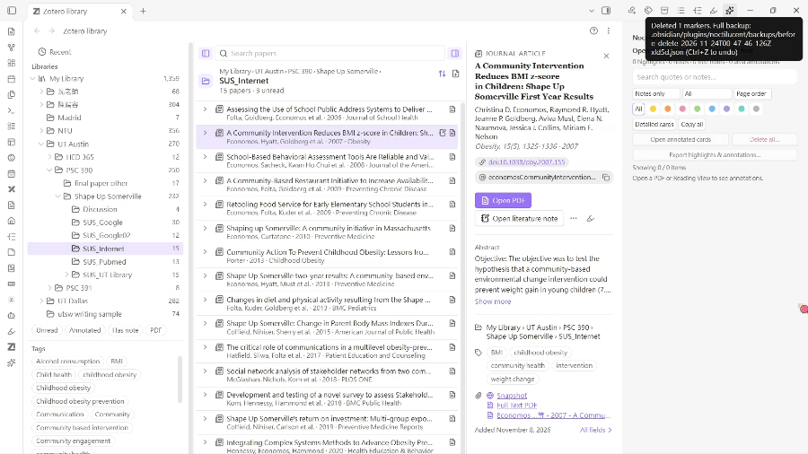

# Noctilucent ✦

**自由高亮，隨需批註，專注閱讀。**

為 Obsidian 設計的沉浸式閱讀與批註插件，整合高亮、原文旁批註、彈性閱讀工具及自訂 Markdown 匯出。

**版本：** 0.2.4 · **平台：** 桌面版 · **授權：** MIT · **最低 Obsidian：** 1.12.0

**語言：** [English](README.md) | 繁體中文

[更新紀錄](CHANGELOG.zh-TW.md) · [Obsidian 社群插件](https://community.obsidian.md/plugins/noctilucent)

## 關於 Noctilucent

名字靈感來自「夜光雲」，一種在高緯度夏夜泛著銀藍色微光的自然現象。它想傳達的是天還未亮、萬籟俱寂，沒有訊息干擾，也沒有外界喧囂，只有螢幕與思緒在發光的那份沉浸與專注。

Noctilucent 為在 Obsidian 中閱讀學術文獻而誕生，將高亮、批註及研究筆記整合在一起，同時保留閱讀空間。

**讓批註工具配合閱讀者，而不是讓閱讀者配合批註工具。**

## v0.2.4 更新亮點

自公開版本 v0.1.9 以來：
- 三種浮動工具列樣式：直向、橫向及圖示收合。
- 各閱讀視窗獨立的工具列方向、位置、顏色及連續高亮設定。
- 三種批註顯示模式：收合、文字預覽及完整編輯卡片。
- 七種 Markdown 匯出版面、兩種分類方式、自訂欄位及儲存位置。
- 實驗性 EPUB 支援，包含圖片區域樣式、不透明度、複製及調整。
- Markdown 閱讀模式的程式碼區塊與行內程式碼高亮。
- 文件格式獨立開關、PDF 效能改善、側邊欄焦點及 EPUB 卡片定位改善。

## 核心功能

### 1. 在原文旁高亮與批註
高亮不需要附註。可稍後新增批註，滑鼠懸停於批註圖示預覽文字，或點擊圖示在原文附近開啟可移動的編輯卡片。可同時開啟多張卡片。

### 2. 八種馬卡龍色系與連續高亮
提供黃、橘、粉、綠、藍、紫、青、灰八種柔和色彩。自由定義研究目的、方法、研究結果等顏色用途。連續模式讓你持續標記，不必反覆點擊工具列。

### 3. 三種批註方式
- 文字高亮：標記重要段落。
- 自由批註：PDF 任意位置留下筆記；EPUB 自由筆記錨定附近文字。
- 區域高亮：標記 PDF 圖片、表格及非文字內容，以及 EPUB 單張支援的圖片。

PDF 與 EPUB 圖片區域提供半透明填色、彩色外框、填色加外框三種樣式，以及填色不透明度調整、區域調整與支援範圍內的圖片複製。

### 4. 彈性浮動工具列
自由拖曳並切換直向、橫向、圖示收合。分割視窗中，各自設定方向、位置、高亮顏色及連續高亮。PDF 繪製工具及 PDF／Markdown 橡皮擦等特殊工具保留互斥機制；批註資料仍共用。橡皮擦及工作階段復原／重做可修正支援的操作，但並非所有刪除都能復原。

### 5. 三種批註顯示模式
側邊欄按鈕循環切換 **收合 → 文字預覽 → 完整卡片 → 收合**。預覽在可定位的批註圖示旁顯示簡潔文字，不開啟完整編輯器；卡片可供編輯。原有懸停預覽仍可使用。

### 6. 側邊欄集中管理
搜尋原文及批註、依顏色篩選、依文件順序或建立時間排序、跳回可定位的原文、編輯內容及顏色、釘選重要批註（每份文件最多三筆）、切換清單密度、複製批註、鎖定目前文件，以及整批刪除與備份保護。

### 7. 為研究整理設計的 Markdown 匯出
將原文與批註匯出成獨立快照，適用於文獻回顧、報告及複習。

| 版面 | 特色 |
|---|---|
| Cards | 卡片式筆記 |
| Report | 報告式整理 |
| Sections | 分區式筆記 |
| Parallel | 原文與批註並列 |
| Matrix | 類表格比較矩陣 |
| Minimal | 精簡排版 |
| Plain | 原生 Markdown |

每種版面均支援文件順序＋釘選或依顏色分組。六種視覺化版面有比例色彩橫條並使用插件 CSS；純 Markdown 不依賴該樣式。可自訂 Vault 相對匯出位置及欄位：來源連結、位置、原文、批註、類型、顏色、建立／修改時間、釘選狀態及 ID。匯出為獨立快照，不會即時同步或覆蓋既有匯出；區域截圖不會自動嵌入。

### 8. 跨文件格式閱讀

| 功能 | PDF | Markdown | DOCX/PPTX | EPUB |
|---|---|---|---|---|
| 文字高亮與批註 | 支援 | 支援 | 預覽 | 預覽 |
| 連續高亮 | 支援 | 支援 | 預覽 | 預覽 |
| 自由批註 | 支援 | — | — | 文字錨定預覽 |
| 區域高亮 | 支援 | — | — | 單張圖片預覽 |
| 圖片複製 | 支援 | — | — | 預覽 |
| 側邊欄及 Markdown 匯出 | 支援 | 支援 | 預覽 | 預覽 |

Markdown 僅支援閱讀模式，包含支援的程式碼區塊及行內程式碼。Office 需要 Office Viewer。各文件格式可獨立開關。

### 9. EPUB 相容性預覽
需搭配 caronchen 的 [ePub Reader](https://github.com/caronchen/obsidian-epub-plugin)（參考實作 v1.0.4）。於文件類型支援設定啟用 EPUB 批註，預設關閉。

支援文字高亮、批註、連續高亮、文字錨定自由筆記、單張 HTML 圖片及支援的行內 SVG 區域、三種區域樣式、5–60% 填色不透明度、圖片內移動與縮放、可存取資源的 PNG 複製與圖片加批註複製、側邊欄及匯出。跨章節跳轉須先手動開啟章節。不自動支援其他 EPUB 閱讀器。

### 10. 本機儲存與原始文件保護
批註儲存在插件本機 data.json，不直接改寫原始文件。不需要帳號或 API Key。整批刪除會建立備份；復原與重做紀錄限工作階段。

## 與其他插件搭配
可透過 Zotlit 開啟 Zotero PDF，Office Viewer 及 ePub Reader 提供各自的閱讀介面，Vittra 可搭配閱讀翻譯。這些不是核心 PDF 功能的必要依賴；相容性取決於閱讀器版本及本機設定。

## 安裝方式

### 社群插件
開啟 Obsidian 設定 → 社群插件，搜尋 Noctilucent，安裝並啟用。v0.2.4 發布後，既有使用者可更新。

### 手動安裝
從 [GitHub Releases](https://github.com/sarahokra/noctilucent/releases) 下載 main.js、manifest.json、styles.css，放入 `<Vault>/.obsidian/plugins/noctilucent/`，重新載入 Obsidian 並啟用。僅桌面版，最低宣告 Obsidian 版本 1.12.0。

**更新前請備份 data.json，安裝時切勿覆蓋或刪除。**

## 介面語言
於 Noctilucent 設定選擇自動、English 或繁體中文。自動模式在 Obsidian 中文語系使用繁體中文，其他語系使用英文。不翻譯或修改使用者內容。

## 資料、隱私及本機檔案存取
批註儲存在 `.obsidian/plugins/noctilucent/data.json`。實驗性 PDF 特殊符號還原功能可能透過桌面檔案系統 API 讀取 Vault 內 PDF，或符合條件的 Vault 外本機 file: PDF，計算 SHA-256 指紋並比對內建索引。這段程式不遞迴掃描檔案系統、不改寫原始 PDF、不上傳 PDF 內容或雜湊值。少量指紋可能保留於工作階段快取。建議定期備份批註。

## 相容性與已知限制
- Markdown 編輯模式不變；首頁類文件排除規則保留。程式碼高亮限單一支援區塊；數學公式及渲染後 Mermaid 不支援。
- Office 依賴可選取文字，部分點陣文字及投影片結構無法可靠定位。
- EPUB 為實驗功能，不支援跨章節選取或任意可重排文字矩形。區域限單張可存取圖片或支援 SVG。無法存取的資源可能無法複製。
- 文件變動、重新排版及閱讀器更新可能影響定位；插件可能隱藏無法可靠定位的標記。
- 匯出為快照，不會即時同步；Office／Markdown 精準文字跳轉不保證。
- 復原／重做限工作階段，支援程度依操作而異；備份為獨立機制。
- 作者已於實際桌面環境使用插件，尚未完成所有平台及第三方閱讀器的回歸測試。

## 開發與意見回饋
[Issues](https://github.com/sarahokra/noctilucent/issues) · [產品設計理念](docs/PRODUCT-VISION.md) · [建置說明](docs/BUILD.md) · [更新紀錄](CHANGELOG.zh-TW.md)

## 授權
[MIT License](LICENSE)。Copyright © 2026 AOI.

*自由高亮，隨需批註，專注閱讀。*
